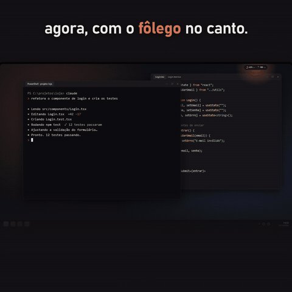
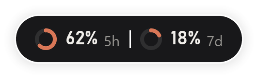
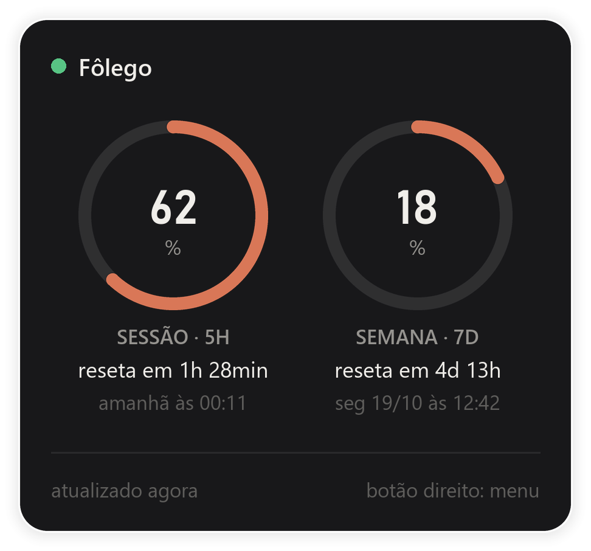

# Fôlego

**Quanto ainda resta do seu Claude, sem sair do que você está fazendo.**

Fôlego é um widget pequeno para Windows que fica no canto da tela e mostra o uso do seu plano do Claude: a sessão de 5 horas, a semana e quanto falta para cada um resetar. Um clique abre os detalhes, outro fecha. Ele também pode ficar só na bandeja, ao lado do relógio.

<p align="center">
  
</p>

> 🇬🇧 *Fôlego is a tiny Windows widget that shows your Claude plan usage (5-hour session and weekly limits) and when each one resets. It gets the numbers from Claude Code itself (its status line, plus a tiny background query every 10 minutes) — it never touches your login or tokens. Unofficial — not affiliated with Anthropic.*

## Por que eu fiz

Eu uso o Claude Code todo dia e batia no limite no meio da tarefa, sem aviso. Para saber quanto ainda restava, eu tinha que parar e digitar `/usage`. O Fôlego deixa essa informação sempre à vista.

## O que ele mostra

| Contraído | Expandido |
| --- | --- |
|  |  |

- **Sessão (5h)** e **semana (7d)**: porcentagem usada, em anéis que mudam de cor a partir de 75% e de 90%.
- **Quanto falta para resetar** e o horário exato do reset.
- **Ícone na bandeja** que enche conforme o uso da sessão. Passe o mouse para ver os números.

## Como usar

- **Clique** no widget: abre ou fecha os detalhes.
- **Arraste**: muda de lugar (ele lembra onde ficou).
- **Botão direito no widget**: minimizar para a bandeja, atualizar agora, iniciar com o Windows, voltar para o canto, conectar/desconectar do Claude Code, ligar/desligar a atualização automática.
- **Ícone da bandeja**: clique mostra/esconde o widget; botão direito → **Sair** fecha o app.

Funciona assim que abre: o Fôlego pede os números ao Claude Code na hora, depois a cada 10 minutos e sempre que você abre o cartão. Isso inclui o uso feito pelo app desktop e pelo chat. Quando você usa o Claude Code no terminal, ele atualiza na hora pela linha de status.

## Instalação

### Opção 1: executável (mais fácil)

1. Baixe o `Folego.exe` na página de [Releases](../../releases).
2. Dê dois cliques. Se o Windows mostrar "O Windows protegeu o computador", clique em **Mais informações → Executar assim mesmo** (o executável não tem assinatura digital paga).

### Opção 2: pelo código (Python 3.10+)

```bash
pip install -r requirements.txt
pythonw folego.pyw
```

### Requisitos

- **Claude Code** instalado (comando `claude` no terminal ou o que vem com o app desktop do Claude) e logado num plano **Pro ou Max**, que são os planos em que o Claude Code informa os limites.
- Só isso. Ao abrir, o Fôlego já busca os números.

## Como funciona

O Fôlego pega os números **do próprio Claude Code**, de duas formas:

1. **Consulta automática (padrão):** a cada 10 minutos, o Fôlego roda o Claude Code escondido com um pedido mínimo (`claude -p` no modelo Haiku, prompt curto, sem MCPs e sem gravar sessão). A resposta do Claude Code traz um evento `rate_limit_event` com a porcentagem de cada janela. Cada consulta processa só alguns milhares de tokens no modelo mais leve, uma fração ínfima do limite. Dá para desligar no menu.
2. **Linha de status:** a [linha de status](https://code.claude.com/docs/en/statusline) é um recurso oficial do Claude Code no terminal. A cada atualização, ele entrega a um comando configurado um JSON com `rate_limits`. É instantâneo e não custa nada.

Na mesma janela (mesmo horário de reset), o uso só sobe; por isso o Fôlego guarda sempre o maior valor e um dado velho de uma sessão parada nunca sobrescreve um mais novo.

- **Conexão:** na primeira vez, o Fôlego configura `statusLine` no seu `~/.claude/settings.json` apontando para o ajudante `folego-status`. Se você já tinha uma linha de status, ela é guardada e continua funcionando: o ajudante repassa os mesmos dados para ela e mostra o que ela imprimir. Desmarcar **Conectado ao Claude Code** no menu devolve a configuração original.
- **`folego_status.py`** (o ajudante) recebe o JSON do Claude Code e salva só os números em `%APPDATA%\Folego\uso.json`.
- **`uso_core.py`** faz a consulta automática, lê o arquivo e cuida de conectar/desconectar a linha de status.
- **`folego.pyw`** desenha a interface com Tkinter + Pillow, usando uma janela com transparência por pixel do Windows (`UpdateLayeredWindow`), e o ícone da bandeja com `pystray`.
- **O Fôlego não lê seu login, não usa tokens e não acessa a internet.** Quem conversa com a Anthropic é sempre o próprio Claude Code.

### Gerar o executável

```bash
pip install pyinstaller
pyinstaller --noconfirm --onefile --console --name folego-status folego_status.py
pyinstaller --noconfirm --onefile --windowed --name Folego --icon folego.ico --hidden-import pystray._win32 --add-binary "dist/folego-status.exe;." folego.pyw
```

## Limitações e avisos

- **Projeto não oficial**, sem vínculo com a Anthropic. "Claude" e "Claude Code" são marcas da Anthropic.
- Com a atualização automática desligada, os números só mudam quando você usa o Claude Code no terminal (a aba Code do app desktop não roda a linha de status).
- Depende dos campos `rate_limit_event` e `rate_limits` do Claude Code; se a Anthropic mudar esse formato, o widget pode precisar de atualização.
- Por enquanto só funciona no **Windows** (10 e 11).

## Próximos passos

- [ ] Versão para Linux
- [ ] Mostrar também o uso de outros assistentes (ex.: Codex)

## Autor

Feito por **Walison Fernandes**, com o Claude Code de parceiro.
[linkedin.com/in/walisonfbalves](https://www.linkedin.com/in/walisonfbalves)

## Licença

[MIT](LICENSE)
